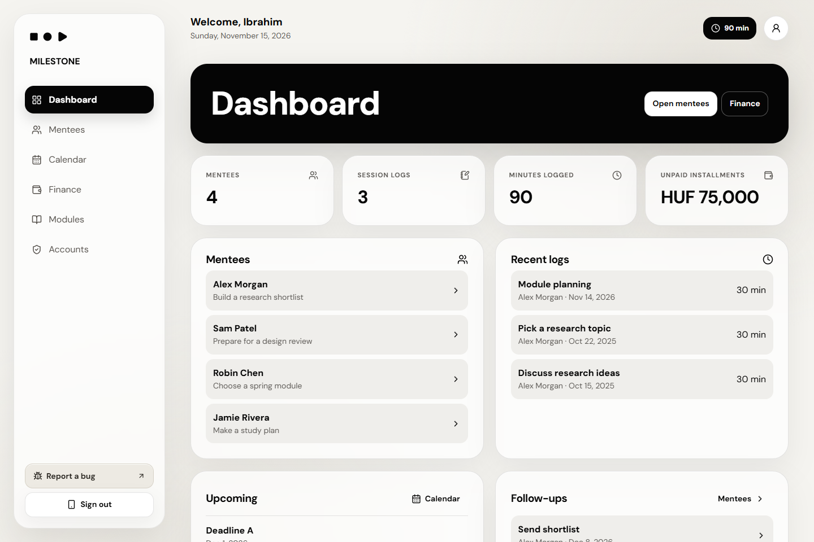
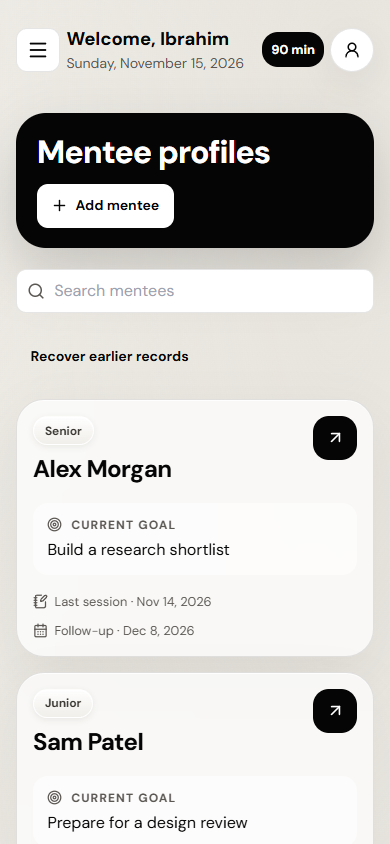

# Milestone OS

Milestone OS gives mentors one place to review a mentee’s goals, record sessions, and follow up on agreed actions. Program administrators can approve accounts and maintain a shared calendar and module catalogue.

[Open Milestone OS](https://milestone-os-two.vercel.app)

## What you can do

- Keep mentee profiles, goals, scratchpads, and module selections.
- Record sessions and due dates. Mark a next action done to clear it from the dashboard, or reopen it from its session log.
- Track meetings and deadlines, open Skedda, and export events to Google or Apple Calendar.
- Record installments and see gross pay, estimated net pay, and money received.
- Approve mentor accounts, publish shared events, and manage modules as an administrator.

## Screenshots

Browser screenshots use sample data and show a single viewport at 100% zoom.

### Desktop dashboard · 1440 × 960



### Mobile mentee profiles · 390 × 844



## Tech stack

- Next.js, React, TypeScript, and Tailwind CSS for the app
- Supabase Auth and PostgreSQL with row-level security
- Vercel for hosting, optional Resend signup alerts, and GitHub Actions for CI

## Run locally

Use Node.js 24. Copy `.env.example` to `.env.local` and configure the project as described in the [Supabase setup guide](docs/setup.md).

```sh
npm ci
npm run dev
```

Open [Milestone OS locally](http://localhost:3000). Run `npm run lint`, `npm run typecheck`, and `npm test` before submitting changes. CI also runs the production build and a Playwright layout regression check at desktop and mobile widths.

## Deploy

Vercel deploys the `master` branch of this repository to production.

Import the repository into Vercel and add the variables from [`.env.example`](.env.example) in the project settings. Use the production URL for `APP_URL` and the Supabase Auth Site URL. Follow the [setup guide](docs/setup.md) for database migrations, email delivery, and the first administrator.

[System diagrams](docs/architecture.md) · [Release notes](https://github.com/ibrahimify/milestoneOS/releases) · [Report a bug](https://github.com/ibrahimify)

## License

Copyright © 2026 Muhammad Ibrahim Shoeb. All rights reserved. See [LICENSE](LICENSE).
