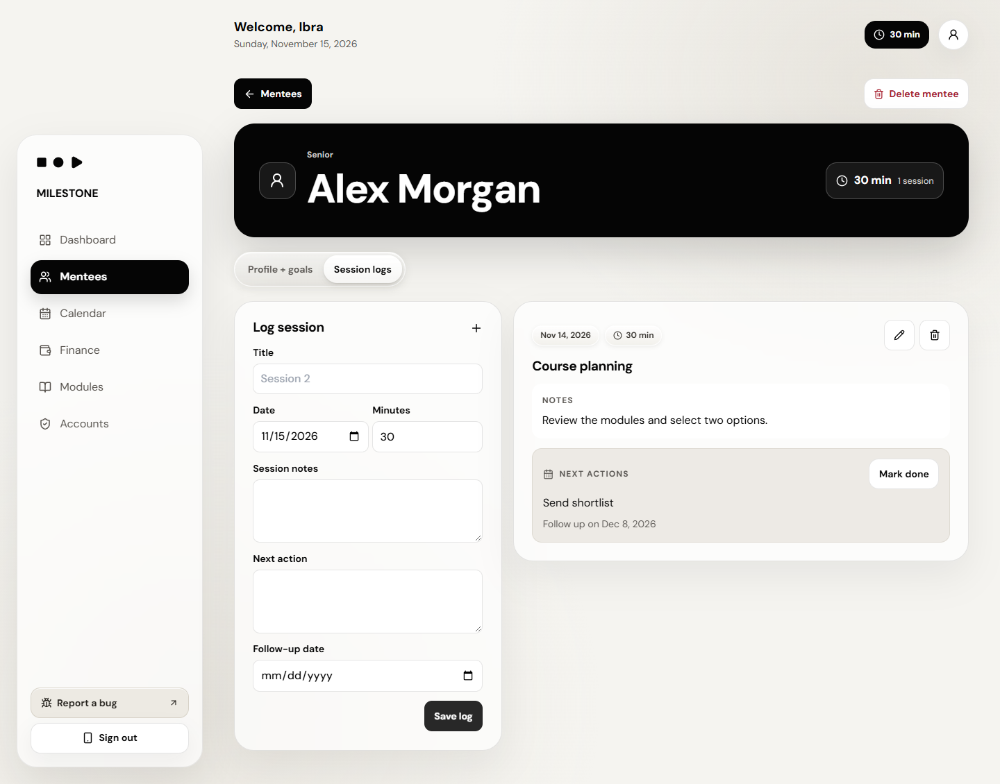
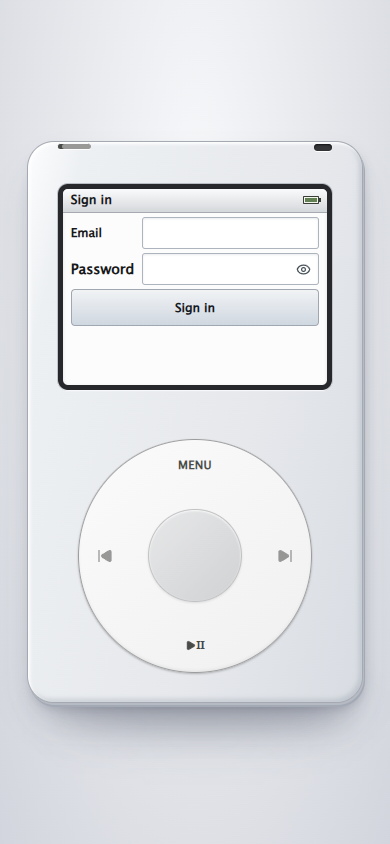
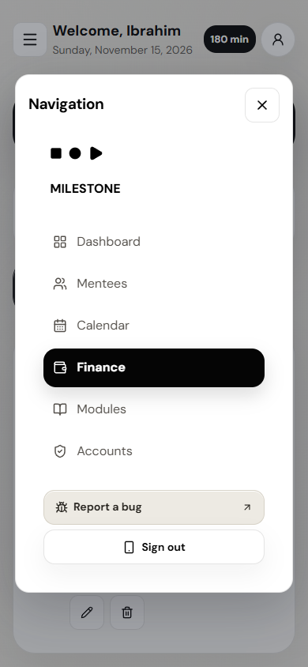

# Milestone OS

Milestone OS is a private workspace for mentors to manage mentees, sessions, follow-ups, calendars, and payments. It runs on Next.js and Supabase.


## Why it exists

A mentor should be able to open a mentee's profile before a meeting and see what happened last time, what comes next, and who needs a follow-up. Milestone OS keeps that work in one place. Administrators approve mentor accounts, share deadlines, and maintain a common module catalogue.

The same workflow can support other mentoring programs. Separate program workspaces and delegated administration are future possibilities. The current release provides private mentor data and a shared catalogue within one installation.

## What you can do

- Keep mentee profiles, goals, scratchpads, and module selections.
- Record sessions and due dates. Mark a next action done to clear it from the dashboard, or reopen it from its session log.
- Track meetings and deadlines, open Skedda, and export events to Google or Apple Calendar.
- Record installments and see gross pay, estimated net pay, and money received.
- Use the admin account to approve mentors, publish shared calendar events, and manage modules.

## Screenshots

Screenshots use sample data.



<p>
  
  
</p>

## Run locally

Use Node.js 24. Copy `.env.example` to `.env.local` and configure the project as described in the [Supabase setup guide](docs/setup.md).

```sh
npm ci
npm run dev
```

Open [Milestone OS locally](http://localhost:3000). Run `npm run lint`, `npm run typecheck`, and `npm test` before submitting changes. CI also runs the production build.

## Deploy

Import the repository into Vercel and add the variables from [`.env.example`](.env.example) in the project settings. Use the production URL for `APP_URL` and the Supabase Auth Site URL. Follow the [setup guide](docs/setup.md) for database migrations, email delivery, and the first administrator.

[System diagrams](docs/architecture.md) · [Release notes](https://github.com/ibrahimify/milestoneOS/releases) · [Report a bug](https://github.com/ibrahimify)
