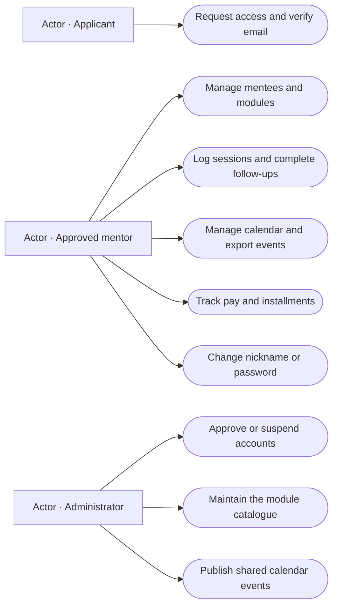
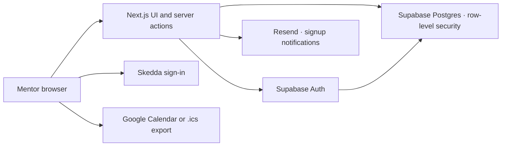
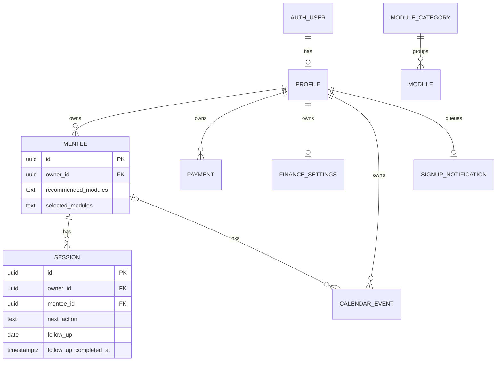
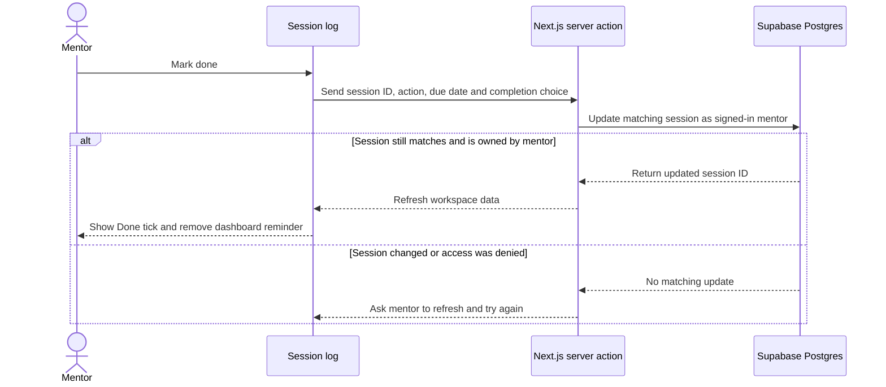
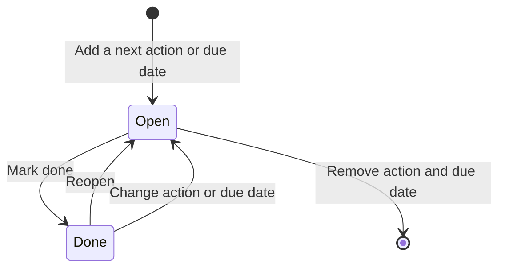

# Milestone OS architecture

## Use cases

## Component and deployment view

## Data model

The catalogue picker stores module IDs in the existing mentee fields. Older text values still resolve by title when a matching catalogue entry exists. Private queries use the signed-in account and row-level security. Approval and module management require an administrator.

## Complete a follow-up

## Follow-up state

